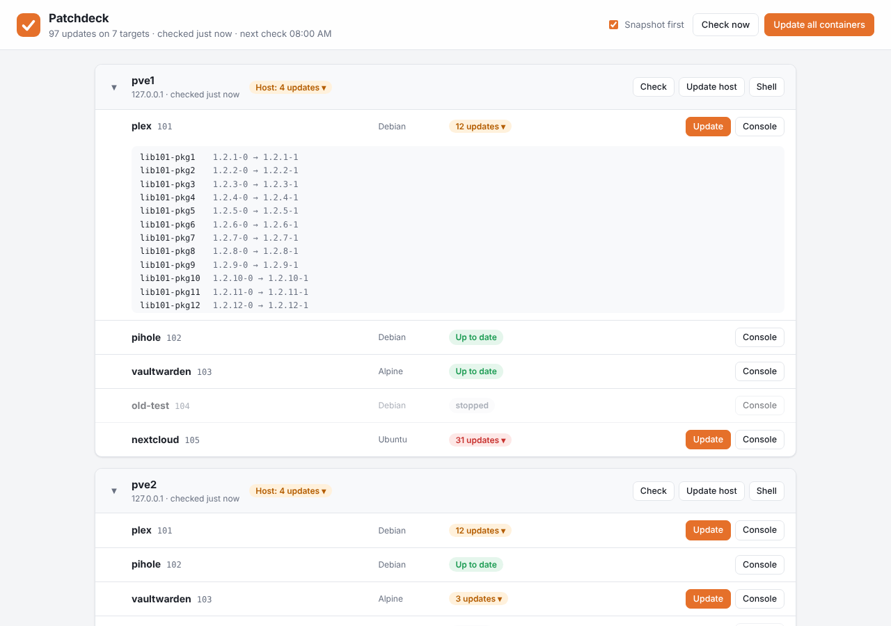

# Patchdeck



A small, self-hosted update dashboard for Proxmox VE hosts and their LXC containers.

- Lists every LXC on each host, grouped by host, with pending update counts and package lists
- **Update** buttons per container, per host, and **Update all containers**
- Optional Proxmox **snapshot before update**, with old pre-update snapshots pruned automatically
- **Live log** of each update in the page
- **Console** buttons that open the Proxmox console (or Nexterm, or any URL you configure)
- Scheduled checks with a **Discord** summary, plus a message when updates finish
- Debian, Ubuntu, Devuan and Alpine containers

It connects only to your Proxmox hosts over SSH and runs commands inside containers with
`pct exec`, so containers need no SSH server, key or agent. New containers are picked up automatically.

## Setup

### 1. Create an SSH key and authorise it on each Proxmox host

On the machine (or LXC) that will run Patchdeck:

```bash
mkdir -p data && ssh-keygen -t ed25519 -N '' -C patchdeck -f data/id_ed25519
```

Copy the key to each host:

```bash
ssh-copy-id -i data/id_ed25519.pub root@192.168.1.10
```

Record the hosts' SSH fingerprints so Patchdeck can verify it's talking to the right machine:

```bash
ssh-keyscan 192.168.1.10 192.168.1.11 >> data/known_hosts
```

### 2. Configure

```bash
cp config.example.yaml data/config.yaml
```

Edit `data/config.yaml`: set a password, your hosts, and your Discord webhook
(Discord channel → Edit Channel → Integrations → Webhooks → New Webhook → Copy URL).

### 3. Run it

**Docker:**

```bash
docker compose up -d --build
```

**Or directly in a Debian LXC:**

```bash
apt install -y python3-venv && cp -r . /opt/patchdeck && cd /opt/patchdeck && python3 -m venv venv && venv/bin/pip install -r requirements.txt
```

```bash
cp patchdeck.service /etc/systemd/system/ && systemctl enable --now patchdeck
```

Open `http://<ip>:8080` and sign in with the username and password from the config.
The first check runs on startup.

## Security notes

- The SSH key gives root on your Proxmox hosts. Keep `data/` private and only expose Patchdeck
  on your LAN or Tailscale, not the internet.
- Login uses HTTP Basic auth, so use HTTPS (e.g. `tailscale serve`) if you reach it from outside your LAN.

## How updates run

- Containers: `apt-get dist-upgrade` (keeping existing config files) or `apk upgrade`.
- Hosts: `apt-get dist-upgrade`, as Proxmox recommends. Patchdeck doesn't reboot anything; it shows
  **Reboot needed** when a new kernel is installed or a package asks for a reboot.
- Updates run detached on the host, so a dropped connection won't kill `apt` halfway.
- Updates on the same host run one at a time; different hosts run in parallel.
- If a snapshot fails (e.g. the container's storage doesn't support snapshots), the update is
  aborted unless `snapshots.on_failure: continue` is set. Untick **Snapshot first** to skip it.
